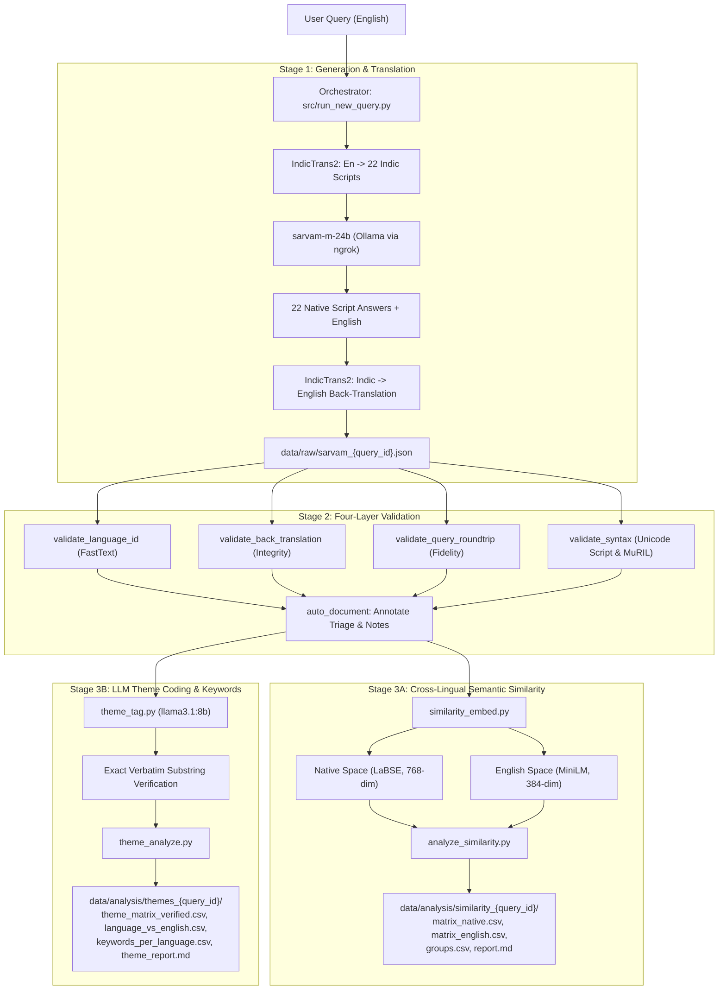

# Pluralistic LLMs

An evaluation framework designed to quantify cultural, conceptual, and linguistic pluralism in Large Language Models (specifically `sarvam-m-24b` and `llama3.1:8b`) across all **22 eighth-schedule Indian languages** plus an English baseline.

The framework investigates whether multilingual models produce uniform, culturally westernized/English-centric answers when prompted across Indian languages, or whether they express distinct regional perspectives, priorities, and cultural values.

---

## Table of Contents

- [Project Overview](#project-overview)
- [Key Features](#key-features)
- [Technology Stack](#technology-stack)
- [Project Structure](#project-structure)
- [Architecture & Request Flow](#architecture--request-flow)
- [Setup and Installation](#setup-and-installation)
  - [Prerequisites](#prerequisites)
  - [Virtual Environments & Dependencies](#virtual-environments--dependencies)
  - [Model Assets](#model-assets)
- [Environment Variables & Configuration](#environment-variables--configuration)
- [Running and Testing](#running-and-testing)
  - [1. Single-Command End-to-End Execution](#1-single-command-end-to-end-execution)
  - [2. Running Individual Pipeline Stages](#2-running-individual-pipeline-stages)
  - [3. Running Unit Tests](#3-running-unit-tests)
- [Important Workflows](#important-workflows)
  - [Generation & Multilingual Translation](#1-generation--multilingual-translation)
  - [Four-Layer Validation](#2-four-layer-validation)
  - [Cross-Lingual Semantic Similarity Analysis](#3-cross-lingual-semantic-similarity-analysis)
  - [LLM-Assisted Theme Coding & Keyword Extraction](#4-llm-assisted-theme-coding--keyword-extraction)
- [Development Guidelines](#development-guidelines)
- [Troubleshooting](#troubleshooting)

---

## Project Overview

When prompted with open-ended life questions (e.g., self-image, state characteristics, self-development tips), multilingual language models may either:
1. Translate a single uniform set of values into different scripts (monocultural homogenization), or
2. Reflect genuine cultural and conceptual divergence reflecting the speakers of those languages (pluralism).

This repository automates the full research loop:
- Translates queries from English into 22 scheduled Indian languages using local **IndicTrans2** models.
- Generates native responses from `sarvam-m-24b` (served remotely via Ollama / ngrok).
- Back-translates native responses into English using IndicTrans2.
- Applies a 4-tier validation suite (Unicode script integrity, FastText language ID, back-translation coherence, round-trip fidelity).
- Evaluates **Cross-Lingual Semantic Similarity** in dual vector spaces (Native LaBSE $\mathbb{R}^{768}$ vs. English MiniLM $\mathbb{R}^{384}$) with Spearman rank correlation and linguistic group clustering.
- Executes **LLM-Assisted Theme Coding** using `llama3.1:8b` with deterministic verbatim quote verification (hallucination guard) and set-theoretic Jaccard overlap.

---

## Key Features

- **22 Scheduled Indian Languages + English Baseline**: Full coverage of Assamese, Bengali, Bodo, Dogri, Gujarati, Hindi, Kannada, Kashmiri, Konkani, Maithili, Malayalam, Manipuri (Meetei Mayek/Bengali), Marathi, Nepali, Odia, Punjabi, Sanskrit, Santali (Ol Chiki), Sindhi (Devanagari/Perso-Arabic), Tamil, Telugu, and Urdu.
- **Robust Prompting with Explicit Script Binding**: Eliminates Latin leakage and script confusion by enforcing both language and target script directly in generation system prompts.
- **Four Independent Quality Validators**:
  - `validate_language_id`: FastText (`lid218e`) language verification with neighbor-ambiguity handling.
  - `validate_back_translation`: Checks for translation collapse, repetitive loops, and topic retention.
  - `validate_query_roundtrip`: Verifies that translated queries retain source intent when round-tripped to English.
  - `validate_syntax`: Deterministic Unicode block verification plus optional MuRIL pseudo-perplexity.
- **Dual-Space Semantic Similarity Engine**:
  - Evaluates pairwise $23 \times 23$ cosine similarity matrices in native script space (LaBSE) and back-translated English space (MiniLM).
  - Cross-space validation via Spearman rank correlation ($r_s$) to detect translation artifacts.
  - Stratification by language family (Indo-Aryan, Dravidian, Tibeto-Burman, Austroasiatic) and script groups.
- **Verbatim-Verified Theme Coding (Hallucination Guard)**:
  - Generates or applies standardized codebooks (5–6 themes per topic).
  - Evaluates back-translations with language-blind prompts using `llama3.1:8b`.
  - Deterministically verifies claims by requiring 100% exact substring quotes from the source text.
  - Computes Jaccard conceptual overlap against English and Cohen's Kappa inter-rater agreement.
- **Autonomous Multi-Keyword Extraction**: Extracts salient lexical concepts using LLM keywords, TF-IDF unigram/bigram statistical scoring, and KeyBERT embeddings.
- **Resume-Safe Pipeline Architecture**: Atomic file writes, SHA-256 dataset tracking, and merge-aware validation storage to prevent accidental data loss.

---

## Technology Stack

| Layer / Component | Technology / Library | Purpose |
| :--- | :--- | :--- |
| **Generation Model** | `sarvam-m-24b` (GGUF via Ollama) | Multilingual generation across 22 Indic languages |
| **Evaluator Model** | `llama3.1:8b` (Ollama via ngrok) | Language-blind theme tagging & codebook generation |
| **Machine Translation** | `AI4Bharat/indictrans2` (1B model pair) | En $\leftrightarrow$ Indic bidirectional offline translation |
| **Language Identification**| `fastText` (`lid.176.ftz` / `lid218e`) | Verifies predicted language of generated native answers |
| **Script Validation** | Python `unicodedata` / Regex | Deterministic Unicode range check per Indian script |
| **Fluency Scoring** | `google/muril-base-cased` | Bidirectional masked language model pseudo-perplexity |
| **Native Embeddings** | `sentence-transformers/LaBSE` | 768-dim multilingual vector space for native scripts |
| **English Embeddings** | `all-MiniLM-L6-v2` | 384-dim semantic sentence embedding space |
| **Metrics & Analytics** | NumPy, SciPy, scikit-learn | Cosine matrices, Spearman $r_s$, Jaccard index, Cohen's $\kappa$, TF-IDF |
| **Runtime & Shell** | Python 3.10+, Bash | Pipeline orchestration and batch processing |

---

## Project Structure

```
Pluralistic_LLMs/
├── config/
│   ├── codebooks/               # Approved thematic codebooks (JSON) per query
│   │   ├── self_dev_tips.json
│   │   └── self_image_life_goal.json
│   ├── prompts/                 # Evaluator prompts (e.g. theme_tagging_v1.txt)
│   ├── language_groups.json     # Family (Indo-Aryan, Dravidian, etc.) & script groupings
│   ├── languages.json           # Metadata for 22 languages: codes, scripts, and detector aliases
│   ├── lid.176.ftz              # FastText compressed language identification model
│   └── stopwords_en.txt         # Stopwords list for TF-IDF / KeyBERT extraction
├── data/
│   ├── analysis/                # Analytical outputs per query (matrices, reports, tags)
│   │   ├── similarity_<query_id>/  # Cosine matrices, Spearman rank, groups.csv, report.md
│   │   └── themes_<query_id>/      # Theme tags, frequency, Jaccard overlap, keywords
│   ├── consolidated/            # Historical baseline records
│   └── raw/                     # Generated responses and merged validation metadata
│       └── sarvam_<query_id>.json
├── docs/                        # Research documentation and mathematical derivations
│   └── analysis_and_mathematical_derivation.md
├── models/                      # Offline weights (IndicTrans2, LaBSE, MiniLM, MuRIL)
│   ├── all-MiniLM-L6-v2/
│   ├── indictrans2/
│   │   ├── indictrans2-en-indic/
│   │   └── indictrans2-indic-en/
│   ├── labse/
│   └── muril-base-cased/
├── src/                         # Application modules
│   ├── analyze_similarity.py    # Cross-lingual similarity analysis & report generator
│   ├── auto_document.py         # Automated review triage & dataset notes
│   ├── indic_translate.py       # IndicTrans2 wrapper (preprocess, tokenize, postprocess)
│   ├── logging_config.py        # Centralized logger setup and PROJECT_ROOT resolver
│   ├── pipeline_sarvam.py       # Query generation, translation loop, and Ollama client
│   ├── run_new_query.py         # End-to-end CLI orchestrating Stages 1, 2A, and 2B
│   ├── schema.py                # EvaluationRecord dataclass definition
│   ├── similarity_core.py       # Vector math: cosine similarity, Spearman, group cohesion
│   ├── similarity_embed.py      # Batch embedding generation (LaBSE + MiniLM)
│   ├── theme_analyze.py         # Theme analysis: Jaccard, prevalence, TF-IDF, reports
│   ├── theme_core.py            # Theme verification algorithms & prompt renderers
│   ├── theme_tag.py             # LLM theme tagging client with resume support
│   ├── validate_back_translation.py  # Validation: English coherence and topic retention
│   ├── validate_language_id.py       # Validation: FastText language detector
│   ├── validate_query_roundtrip.py   # Validation: Query round-trip semantic check
│   ├── validate_syntax.py            # Validation: Unicode script check & MuRIL fluency
│   └── validation_io.py              # Atomic JSON merge/update utilities
├── tests/                       # Unit test suite
│   ├── test_similarity_core.py       # Math validation for cosine, Spearman, and cohesion
│   ├── test_similarity_followup.py   # Environment and model resolution tests
│   └── test_theme_core.py            # Quote verification, Jaccard, and prompt tests
├── ARCHITECTURE.md              # Historical request flow reference
├── run_pipeline.sh              # Bash execution wrapper with health check
└── README.md                    # Project documentation (this file)
```

---

## Architecture & Request Flow



---

## Setup and Installation

### Prerequisites
- **Linux OS** (Ubuntu 20.04/22.04 LTS recommended).
- **Python 3.10+**.
- **GPU (optional)**: Recommended for local IndicTrans2 translation; CPU fallback is fully supported.
- **Ollama Host**: A remote server running `sarvam-m-24b` and `llama3.1:8b` exposed via ngrok or direct network access.

### Virtual Environments & Dependencies
To isolate heavy dependencies (IndicTrans2 PyTorch stack, sentence-transformers, FastText), the repository uses three specialized virtual environments:

1. **`.venv-it2` (Primary Pipeline & Translation)**:
   ```bash
   python3 -m venv .venv-it2
   source .venv-it2/bin/activate
   pip install torch torchaudio torchvision --index-url https://download.pytorch.org/whl/cpu  # or cu118/cu121
   pip install transformers sentencepiece sacremoses IndicTransToolkit requests
   deactivate
   ```
2. **`.venv` (FastText Validator)**:
   ```bash
   python3 -m venv .venv
   source .venv/bin/activate
   pip install fasttext-wheel requests
   deactivate
   ```
3. **`.venv-sim` (Similarity Analysis & Keyword Extraction)**:
   ```bash
   python3 -m venv .venv-sim
   source .venv-sim/bin/activate
   pip install sentence-transformers scikit-learn scipy numpy
   deactivate
   ```

### Model Assets
Because ML models are large binary files, they are excluded from git via `.gitignore` (`models/`, `*.ftz`). Before running the pipeline, a newly cloned repository requires these model checkpoints:

1. **IndicTrans2 Models** (`models/indictrans2/`):
   Download the 1B translation models from Hugging Face into `models/indictrans2/`:
   ```bash
   mkdir -p models/indictrans2
   git clone https://huggingface.co/ai4bharat/indictrans2-en-indic-1B models/indictrans2/indictrans2-en-indic
   git clone https://huggingface.co/ai4bharat/indictrans2-indic-en-1B models/indictrans2/indictrans2-indic-en
   ```
2. **FastText Language ID Model** (`config/lid.176.ftz`):
   Download the compressed language identification model:
   ```bash
   wget -O config/lid.176.ftz https://dl.fbaipublicfiles.com/fasttext/supervised-models/lid.176.ftz
   ```
3. **Sentence Transformers (LaBSE & all-MiniLM-L6-v2)**:
   You can auto-download them using the built-in downloader:
   ```bash
   .venv-sim/bin/python -m src.similarity_embed --download
   ```
   Or manually clone them into `models/`:
   ```bash
   git clone https://huggingface.co/sentence-transformers/LaBSE models/labse
   git clone https://huggingface.co/sentence-transformers/all-MiniLM-L6-v2 models/all-MiniLM-L6-v2
   ```

---

## Environment Variables & Configuration

| Variable | Purpose | Default / Fallback | Required |
| :--- | :--- | :--- | :--- |
| `OLLAMA_BASE_URL` | Public ngrok/HTTP endpoint pointing to Ollama | Set via CLI `--url` | Yes (for generation/tagging) |
| `OLLAMA_MODEL` | Target generation model identifier | `sarvam-m-24b` | No |
| `EVAL_MODEL` | Evaluator model for theme coding | `llama3.1:8b` | No |

---

## Running and Testing

### 1. Single-Command End-to-End Execution
To execute the complete research workflow for a new query (Generation $\to$ 4 Validators $\to$ Auto-Documentation $\to$ Similarity Analysis $\to$ Theme Coding):

```bash
.venv-it2/bin/python -m src.run_new_query \
  --query-id self_dev_tips \
  --query-text "Can you give 3 short tips for self development?" \
  --url https://your-ngrok-url.ngrok-free.dev \
  --skip-muril
```

> **Why `--skip-muril`?**
> MuRIL masked-language-model pseudo-perplexity computes $O(T)$ bidirectional Transformer forward passes over a 197k Indic vocabulary head. On CPU, this takes 45–90+ minutes per query. Skipping it runs Layer 1 Unicode script validation in $<0.001$s with **zero effect on downstream similarity or theme coding**.

---

### 2. Running Individual Pipeline Stages

#### Step A: Generation & Translation
```bash
.venv-it2/bin/python -m src.pipeline_sarvam \
  --query-id self_image_life_goal \
  --query-text "Can you give an example of a life goal related to self-image?"
```

#### Step B: Four-Layer Validation
```bash
.venv/bin/python -m src.validate_language_id --query-id self_image_life_goal
.venv-it2/bin/python -m src.validate_back_translation --query-id self_image_life_goal
.venv-it2/bin/python -m src.validate_query_roundtrip --query-id self_image_life_goal
.venv-it2/bin/python -m src.validate_syntax --query-id self_image_life_goal --skip-muril
.venv-it2/bin/python -m src.auto_document --query-id self_image_life_goal
```

#### Step C: Cross-Lingual Semantic Similarity
```bash
.venv-sim/bin/python -m src.analyze_similarity --query-id self_image_life_goal
```
Outputs generated in `data/analysis/similarity_self_image_life_goal/`:
- `matrix_native.csv`: $23 \times 23$ cosine similarity matrix (LaBSE).
- `matrix_english.csv`: $23 \times 23$ cosine similarity matrix (MiniLM).
- `groups.csv`: Within-group cohesion vs. between-group separation by family and script.
- `report.md`: Complete summary report with Spearman rank correlation and outlier analysis.

#### Step D: Theme Coding & Keyword Extraction
```bash
# Tag themes using LLM (auto-generates codebook if not present)
.venv-it2/bin/python -m src.theme_tag \
  --query-id self_image_life_goal \
  --url https://your-ngrok-url.ngrok-free.dev \
  --model llama3.1:8b

# Analyze tags, verified occurrences, and keyword distributions
.venv-sim/bin/python -m src.theme_analyze --query-id self_image_life_goal
```
Outputs generated in `data/analysis/themes_self_image_life_goal/`:
- `theme_matrix_verified.csv`: Binary presence matrix ($23 \times K$) verified by exact quotes.
- `language_vs_english.csv`: Jaccard index overlap against English.
- `theme_frequency.csv`: Prevalence distribution across all languages.
- `keywords_per_language.csv`: Top LLM, TF-IDF, and KeyBERT keywords per language.
- `theme_report.md`: Markdown report synthesizing thematic pluralism.

---

### 3. Running Unit Tests
All core mathematical operations, quote verification routines, and prompt renderers are covered by unit tests:

```bash
.venv-sim/bin/python -m unittest discover -s tests -t . -v
```

---

## Important Workflows

### 1. Generation & Multilingual Translation
- Reads `config/languages.json`.
- Translates the English query into 22 Indian languages via `IndicTrans2` using language-specific FLORES tags (handling dual-script languages like Kashmiri `kas_Arab`, Manipuri `mni_Beng`, and Sindhi `snd_Arab`).
- Sends the prompt to `sarvam-m-24b` with explicit instructions to respond strictly in the target language and script.
- Back-translates each native response into English to produce parallel corpora stored in `data/raw/sarvam_<query_id>.json`.

### 2. Four-Layer Validation
- Validates the integrity of the generated dataset before conducting semantic analytics.
- Categorizes detection anomalies: distinguishes between legitimate script confusions (e.g. Konkani vs. Marathi in Devanagari) and true generation failures.
- `src/validation_io.py` writes validation outputs into `sarvam_<query_id>.json` using atomic replace operations so ongoing runs can safely resume.

### 3. Cross-Lingual Semantic Similarity Analysis
- Embeds native texts using LaBSE ($\mathbb{R}^{768}$) and back-translations using MiniLM ($\mathbb{R}^{384}$).
- Computes pairwise cosine similarity Gram matrices: $\mathbf{S} = \mathbf{V} \mathbf{V}^T$.
- Measures rank-order agreement between native and English spaces using Spearman's rank correlation:
  $$r_s = 1 - \frac{6 \sum d_k^2}{M(M^2 - 1)}$$
- Groups languages by family (Indo-Aryan, Dravidian, Tibeto-Burman, Austroasiatic) to evaluate whether models cluster along linguistic lines.

### 4. LLM-Assisted Theme Coding & Keyword Extraction
- Uses `llama3.1:8b` under a language-blind prompt (the evaluator does not know which language produced the back-translation).
- Strict hallucination prevention: every tagged theme must include a verbatim quote from the text. The pipeline runs a string matching algorithm to verify that the quote is an exact substring; unverified claims are dropped.
- Computes set-theoretic overlap using the Jaccard similarity index:
  $$J(A, B) = \frac{|A \cap B|}{|A \cup B|}$$
- Extracts keywords using three complementary paradigms: LLM thematic phrases, corpus TF-IDF unigram/bigrams, and KeyBERT document embeddings.

---

## Development Guidelines

- **Preserve Read-Only Datasets**: Never overwrite or delete baseline raw datasets (`data/raw/` and `data/consolidated/`). The write path in `src/validation_io.py` is strictly merge-aware.
- **Maintain Language Code Standards**: Always use BCP-47 language codes with regional suffixes (e.g., `hi-IN`, `ta-IN`, `sat-IN`, `ks-IN`) as specified in `config/languages.json`.
- **Decoupled Evaluators**: The evaluator model (`llama3.1:8b`) must remain distinct from the generation model (`sarvam-m-24b`) to prevent self-grading bias.
- **Verification First**: Any new qualitative metric must be anchored in deterministic checks (e.g. substring verification) rather than relying exclusively on unverified LLM claims.

---

## Troubleshooting

### 1. `NameError: name 're' is not defined` in `theme_tag.py`
- Ensure you are running the latest version of `src/theme_tag.py`, where `re` is imported at the top of the file for regex theme ID sanitization.

### 2. Ollama Ngrok Tunnel Returns 403 / 404
- Ngrok tunnels expire after periods of inactivity. Restart the tunnel on the server hosting Ollama.
- Ensure Ollama is bound to all network interfaces: `OLLAMA_HOST=0.0.0.0:11434`.
- The pipeline automatically supplies the `ngrok-skip-browser-warning: true` header to bypass ngrok landing pages.

### 3. Script Validation Flags Sindhi (`sd-IN`)
- Sindhi is officially written in both Devanagari and Perso-Arabic scripts in India.
- The pipeline configuration in `config/languages.json` explicitly recognizes both scripts as valid.

### 4. Pipeline Appears Frozen on `validate_syntax`
- If `--skip-muril` is omitted, MuRIL calculates pseudo-perplexity via thousands of forward passes on CPU. Pass `--skip-muril` to complete script validation in $<0.001$ seconds.
